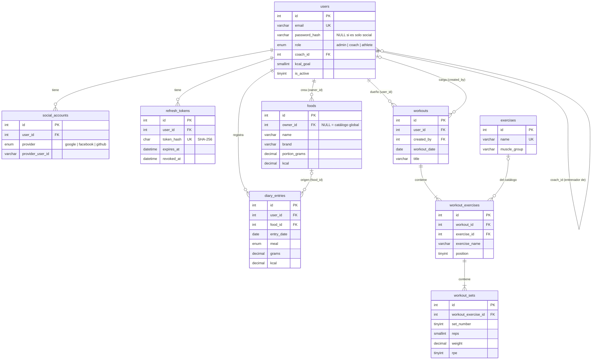

# Base de datos · Modelo e índices

MySQL 8 · motor InnoDB · `utf8mb4_unicode_ci` (acentos y emojis).
El esquema completo está en [`backend/database/schema.sql`](../backend/database/schema.sql).

## Índice

1. [Diagrama entidad-relación](#1-diagrama-entidad-relación)
2. [Tablas](#2-tablas)
3. [Índices: qué consulta usa cada uno](#3-índices-qué-consulta-usa-cada-uno)
4. [Decisiones de diseño](#4-decisiones-de-diseño)
5. [Cómo verificar los índices](#5-cómo-verificar-los-índices)

## 1. Diagrama entidad-relación



## 2. Tablas

| Tabla | Para qué sirve | Borrado del padre |
|---|---|---|
| `users` | Cuentas, rol, entrenador asignado y objetivos diarios | Si se borra el coach, sus atletas quedan con `coach_id = NULL` |
| `social_accounts` | Vincula un usuario con su cuenta de Google, Facebook o GitHub | `CASCADE` |
| `refresh_tokens` | Hash de cada token de renovación, para rotarlo y revocarlo | `CASCADE` |
| `foods` | Catálogo global (`owner_id NULL`) y alimentos personales | `CASCADE` (los personales) |
| `diary_entries` | Lo que comió cada usuario cada día, con los macros ya calculados | `CASCADE`. Si se borra el alimento, queda `food_id NULL` |
| `exercises` | Catálogo de ejercicios por grupo muscular | En las sesiones, `exercise_id` pasa a `NULL` |
| `workouts` | Sesión de entrenamiento de un atleta, cargada por él o por su coach | `CASCADE` |
| `workout_exercises` | Ejercicios de una sesión, en orden | `CASCADE` |
| `workout_sets` | Series (reps, kg, RPE) de cada ejercicio | `CASCADE` |

## 3. Índices: qué consulta usa cada uno

Cada índice responde a una consulta concreta de la API. No se agregaron índices "por las dudas",
porque cada uno hace más lenta la escritura.

| Tabla | Índice | Tipo | Columnas | Consulta que acelera |
|---|---|---|---|---|
| `users` | `uq_users_email` | UNIQUE | `email` | Login y registro (`WHERE email = ?`); además impide emails duplicados |
| `users` | `idx_users_role_name` | B-tree compuesto | `role, name` | `GET /users?role=coach` ordenado por nombre (filtra y ordena con el mismo índice) |
| `users` | `idx_users_coach` | B-tree | `coach_id` | "Mis atletas" del entrenador (`WHERE coach_id = ?`) |
| `social_accounts` | `uq_social_provider_user` | UNIQUE compuesto | `provider, provider_user_id` | Login social: buscar la cuenta vinculada. Impide vincular dos veces la misma cuenta |
| `refresh_tokens` | `uq_refresh_hash` | UNIQUE | `token_hash` | `POST /auth/refresh` busca por hash |
| `refresh_tokens` | `idx_refresh_user` | B-tree compuesto | `user_id, revoked_at` | Revocar todas las sesiones activas de un usuario |
| `refresh_tokens` | `idx_refresh_expires` | B-tree | `expires_at` | Limpieza de tokens vencidos |
| `foods` | `ft_foods_search` | **FULLTEXT** | `name, brand` | Buscador (`MATCH … AGAINST ('+pollo*' IN BOOLEAN MODE)`). Un `LIKE '%pollo%'` no puede usar índices |
| `foods` | `idx_foods_owner_name` | B-tree compuesto | `owner_id, name` | Catálogo global (`owner_id IS NULL`) o "mis alimentos", ordenado por nombre |
| `foods` | `idx_foods_category` | B-tree | `category` | Filtro y listado de categorías |
| `diary_entries` | `idx_diary_user_date` | B-tree compuesto | `user_id, entry_date` | El día del diario (`=`) y los rangos de `/progress` (`BETWEEN`) |
| `diary_entries` | `idx_diary_food` | B-tree | `food_id` | Clave foránea (`ON DELETE SET NULL` al borrar un alimento) |
| `exercises` | `uq_exercises_name` | UNIQUE | `name` | Evita ejercicios duplicados en el catálogo |
| `exercises` | `idx_exercises_muscle` | B-tree compuesto | `muscle_group, name` | Filtro por grupo muscular, ya ordenado |
| `workouts` | `idx_workouts_user_date` | B-tree compuesto | `user_id, workout_date` | Semana de entrenos y conteo de sesiones en `/progress` |
| `workouts` | `idx_workouts_created_by` | B-tree | `created_by` | Clave foránea al usuario que cargó la sesión |
| `workout_exercises` | `idx_wex_workout` | B-tree compuesto | `workout_id, position` | Cargar los ejercicios de una sesión ya en orden |
| `workout_exercises` | `idx_wex_exercise` | B-tree | `exercise_id` | Clave foránea al catálogo |
| `workout_sets` | `uq_sets_order` | UNIQUE compuesto | `workout_exercise_id, set_number` | Cargar las series en orden. Impide dos "serie 1" en el mismo ejercicio |

**Por qué los índices compuestos van en ese orden:** MySQL usa un índice compuesto de izquierda
a derecha. En `(user_id, entry_date)` primero se filtra por la igualdad (`user_id = ?`) y después
por el rango de fechas, así el motor lee solo las filas de ese usuario en esas fechas. Al revés,
`(entry_date, user_id)`, tendría que recorrer las fechas de **todos** los usuarios.

## 4. Decisiones de diseño

- **Una sola tabla de usuarios con `role`** en lugar de una tabla por rol: los tres roles comparten
  login, perfil y objetivos. El `ENUM` impide valores inválidos.
- **`coach_id` en `users`** (relación 1 a N consigo misma): un atleta tiene un solo entrenador. Si
  se necesitara más de uno, se cambiaría por una tabla intermedia.
- **El diario copia los macros** al registrar: si después alguien edita o borra el alimento del
  catálogo, el historial de lo que comió el usuario no cambia.
- **`workout_exercises.exercise_name`** guarda el nombre por la misma razón: borrar un ejercicio
  del catálogo no rompe las sesiones viejas.
- **Los refresh tokens se guardan hasheados** (SHA-256): si alguien roba la base, no puede usarlos.
- **`DECIMAL` y no `FLOAT`** para gramos, kilos y macros: valores exactos, sin errores de redondeo.
- **Las sesiones se guardan en transacciones**: la sesión, sus ejercicios y sus series se
  guardan todos juntos o no se guarda nada.

## 5. Cómo verificar los índices

```sql
-- ¿Qué índice usa la consulta del diario?
EXPLAIN SELECT * FROM diary_entries WHERE user_id = 3 AND entry_date = '2026-10-15';
-- key = idx_diary_user_date

EXPLAIN SELECT * FROM foods WHERE MATCH(name, brand) AGAINST ('+havanna*' IN BOOLEAN MODE);
-- key = ft_foods_search, type = fulltext

SHOW INDEX FROM workouts;
```

La prueba automática `índices › las consultas principales usan los índices definidos`
(`backend/test/api.test.js`) corre estos `EXPLAIN` en cada `npm test`.
